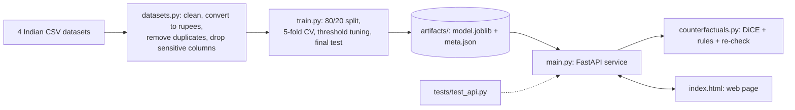

# Group 04 – Applied Machine Learning Project

**Group name:** Power Rangers · **Track 4 – Functional Micro-Prototype / MVP** · **Topic A**

## Team Members
1. Student Name – Enrollment Number
2. Student Name – Enrollment Number
3. Student Name – Enrollment Number
4. Student Name – Enrollment Number

## Project Title

**Loan Pre-Screening on Indian Datasets with Counterfactual Explanations** – a FastAPI microservice that predicts *approve / reject* for a loan application and, for rejections, returns up to three realistic "what to change" suggestions (DiCE counterfactuals) in rupees.

## Project Description

When a bank rejects a loan, the applicant rarely learns **why** or **what to change**. This project builds a small, working web service (an MVP) that:

1. **Predicts** whether a loan application would be approved, using machine-learning models trained on **four public Indian loan datasets**.
2. **Explains rejections** with up to **3 counterfactual suggestions** such as *"raise your CIBIL score from 480 to 640"*, generated with the **DiCE** library under realistic rules (loan amount can only go down, CIBIL score can only go up, etc.).
3. Provides a **simple web page**, **input validation**, **latency reporting** and a **feedback form** for user tests.

**Datasets (all amounts in rupees).** The four datasets have different columns and labels, so **one model is trained and tested per dataset**; the user chooses the loan type in the app.

| Key | Dataset | Rows used | Label (1 = good outcome) | Deployed? |
|---|---|---|---|---|
| `home` | Dream Housing Finance home loans | 614 | Loan approved | Yes |
| `cibil` | Loan approvals with CIBIL score | 4,269 | Loan approved | Yes |
| `behaviour` | Indian customer loan behaviour (252,000 raw rows → 42,006 unique profiles) | 42,006 | Did not default | **No** – no usable signal |
| `vehicle` | L&T Finance vehicle loans | 233,154 | Paid first EMI on time | Yes (low reliability) |

**Data sources** (public GitHub copies of Kaggle / hackathon releases; licences not verified – check before reuse):
- Home loans: https://github.com/shrikant-temburwar/Loan-Prediction-Dataset (Dream Housing Finance "Loan Prediction Problem", Analytics Vidhya)
- CIBIL loans: https://github.com/CherrrYY123/Loan-Approval-Prediction (Kaggle "Loan Approval Prediction Dataset")
- Customer behaviour: https://github.com/SunTam/EligibilityofLoanPrediction (Kaggle "Loan Prediction Based on Customer Behavior")
- Vehicle loans: https://github.com/ShehzadaAlam/Vehicle-Loan-Default-Prediction (L&T Financial Services × Analytics Vidhya FinHack 2019)

> We could not verify how each dataset was originally collected, and some may be partly synthetic. "Indian" here means rupee amounts, CIBIL scores and Indian places.

**Key data decisions**
- Home-loan amounts are stored in thousands of rupees in the source, so they are multiplied by 1,000.
- About **210,000 of the 252,000** behaviour rows are exact duplicates on the model features. They are collapsed to unique profiles **before** splitting, to avoid train/test leakage. After this, that model scores ROC-AUC 0.51 (chance), so the service **refuses to serve it**.
- Gender, marital status, age and city are **not used** by any model.

## Source Code

### Project structure
```
loan_mvp/
├── README.md
├── requirements.txt            exact library versions
├── run.sh                      one-command start (trains only if no model exists)
├── data/indian/                d1_dream_housing_loan.csv, d2_cibil_loan_approval.csv,
│                               d3_indian_loan_behaviour.csv.gz, d4_lt_vehicle_loan.csv.gz,
│                               d4_data_dictionary.xlsx
├── src/
│   ├── config.py               paths, random seed 42, test size 0.2, sample sizes
│   ├── datasets.py             loaders that clean each dataset + SPECS (columns, labels, rules)
│   ├── train.py                split, cross-validation, threshold tuning, test, save artifacts
│   ├── counterfactuals.py      DiCE engine with realism rules and re-checking
│   ├── evaluate.py             suggestion quality, latency, figures, docs/results.json
│   └── summarize_feedback.py   averages of user-test ratings
├── app/
│   ├── main.py                 FastAPI service
│   └── static/index.html       web page (HTML + CSS + JavaScript)
├── artifacts/{home,cibil,behaviour,vehicle}/   model.joblib, meta.json, samples
├── docs/                       results.json, figures/, screenshots/, user_tests/
└── tests/test_api.py           6 automated tests
```

### How to run
```bash
python -m venv .venv && source .venv/bin/activate
pip install -r requirements.txt

cd src && python train.py && python evaluate.py && cd ..   # optional: trained artifacts are included
./run.sh                          # web page: http://localhost:8000   API docs: http://localhost:8000/docs
python -m pytest -q tests         # 6 automated tests
python src/summarize_feedback.py  # averages of user-test ratings (after testers submit feedback)
```

### Key code 1 – model pipeline (`src/train.py`)
One pipeline per model keeps preprocessing identical in training, testing and the live service.
```python
def build(kind, spec):
    num, cat = spec["numeric"], spec["categorical"]
    if kind == "hgb":   # tree model on ordinal-coded categoricals
        pre = ColumnTransformer([
            ("num", SimpleImputer(strategy="median"), num),
            ("cat", Pipeline([("imp", SimpleImputer(strategy="most_frequent")),
                              ("ord", OrdinalEncoder(handle_unknown="use_encoded_value", unknown_value=np.nan))]), cat)])
        mask = [False] * len(num) + [True] * len(cat)
        clf = HistGradientBoostingClassifier(max_iter=250, learning_rate=0.06, max_leaf_nodes=24,
                                             min_samples_leaf=40, l2_regularization=1.0,
                                             categorical_features=mask if cat else None,
                                             class_weight="balanced", random_state=RANDOM_STATE)
    else:
        pre = ColumnTransformer([
            ("num", Pipeline([("imp", SimpleImputer(strategy="median")), ("sc", StandardScaler())]), num),
            ("cat", Pipeline([("imp", SimpleImputer(strategy="most_frequent")),
                              ("oh", OneHotEncoder(handle_unknown="ignore", sparse_output=False))]), cat)])
        clf = (LogisticRegression(max_iter=3000, class_weight="balanced") if kind == "lr" else
               RandomForestClassifier(n_estimators=300, min_samples_leaf=3, class_weight="balanced",
                                      random_state=RANDOM_STATE, n_jobs=-1))
    return Pipeline([("pre", pre), ("clf", clf)])
```

### Key code 2 – realistic counterfactual rules (`src/counterfactuals.py`)
```python
    def _allowed(self, a: dict):
        rng, vary = {}, []
        for f, rule in self.meta["actions"].items():
            kind, cur = rule[0], a[f]
            if kind == "down":
                lo = min(self.meta["p01"][f], cur)
                if cur > lo: rng[f] = [int(lo), int(cur)]; vary.append(f)
            elif kind == "up":
                hi = max(self.meta["p99"][f], cur)
                if cur < hi: rng[f] = [int(cur), int(hi)]; vary.append(f)
            elif kind == "range":
                lo, hi = min(rule[1], cur), max(rule[2], cur)
                if lo < hi: rng[f] = [int(lo), int(hi)]; vary.append(f)
            elif kind == "cat_to":
                tg = [t for t in rule[1] if t != cur]
                if cur not in rule[1] and tg: rng[f] = [cur] + tg; vary.append(f)
        return rng, vary
```

### Key code 3 – prediction endpoint (`app/main.py`)
```python
@app.post("/predict/{key}")
def predict(key: str, body: dict = Body(...)):
    t0 = time.perf_counter()
    item = _get(key); m = item["meta"]
    try:
        data = item["schema"].model_validate(body).model_dump()
    except ValidationError as e:
        return JSONResponse(status_code=422, content={"detail": json.loads(e.json())})
    p = item["engine"].p_approve(data)
    approve = p >= m["threshold"]
    t1 = time.perf_counter()
    cfs = [] if approve else item["engine"].explain(data, n=3)
    t2 = time.perf_counter()
    return {"loan_type": key, "decision": "approve" if approve else "reject",
            "approval_probability": round(p, 3), "decision_threshold": round(m["threshold"], 3),
            "counterfactuals": cfs, "reliability": m["reliability"],
            "model_test_accuracy": round(m["test"]["accuracy"], 3),
            "latency_ms": {"prediction": round((t1 - t0) * 1000, 1), "counterfactuals": round((t2 - t1) * 1000, 1),
                           "total": round((t2 - t0) * 1000, 1)},
            "disclaimer": "This is only a quick check, not a final bank decision."}
```

### API endpoints
| Method | Path | Purpose |
|---|---|---|
| GET | `/health` | Liveness and list of loaded models |
| GET | `/models` | Loan types with accuracy, baseline and reliability |
| GET | `/schema/{type}` | Form fields, allowed ranges/categories and defaults |
| POST | `/predict/{type}` | Decision, approval chance, 0–3 suggestions, latency |
| POST | `/feedback` | Saves a user-test rating |
| GET | `/` | The web page |

## Project Design

### Architecture


### Training pipeline (`src/train.py`)
1. **Load and clean** one dataset through its loader in `datasets.py` (`target` = 1 means a good outcome).
2. **Split** 80/20, stratified, `random_state=42`. The test set is used once at the end.
3. **Compare models** with 5-fold stratified cross-validation (ROC-AUC) on training data only: logistic regression, random forest (small datasets only) and histogram gradient boosting. Gradient boosting won on all four.
4. **Tune the decision threshold** on a 20% validation slice of the training data by maximising balanced accuracy; **refit** the winner on the full training split.
5. **Evaluate on the test set:** accuracy, baseline, balanced accuracy, ROC-AUC, precision/recall/F1, confusion matrix.
6. **Save** the pipeline, `meta.json` (threshold, allowed ranges, defaults, categories, scores, reliability) and samples.
7. **Deployment rule:** a model is served only if test ROC-AUC ≥ 0.6. Reliability grade: ≥0.90 High, ≥0.75 Moderate, ≥0.60 Low, otherwise "No usable signal".

### Model design
- **Preprocessing (inside the Pipeline):** median imputation for numbers, most-frequent imputation for categories; ordinal encoding for gradient boosting, scaling + one-hot encoding for logistic regression / random forest.
- **Final model:** `HistGradientBoostingClassifier` (up to 250 rounds, learning rate 0.06, 24 leaves, ≥40 samples per leaf, L2 = 1.0, balanced class weights).

### Counterfactual (suggestion) design
For a rejected applicant, `CounterfactualEngine` (a) builds per-applicant permitted ranges from the allowed actions, (b) asks DiCE (random method) for 8 candidates that the model approves, (c) rounds them and **re-checks each with the real model and threshold**, (d) removes repeats, and (e) returns the 3 smallest changes.

| Loan type | What suggestions may change (everything else is frozen) |
|---|---|
| home | loan amount ↓ · loan period 60–360 months · co-applicant income ↑ · credit history → "Meets bank guidelines" |
| cibil | loan amount ↓ · loan period 2–20 years · CIBIL score ↑ · bank deposits ↑ |
| vehicle | loan amount ↓ · bureau score ↑ · overdue accounts ↓ · late-payment accounts ↓ |

### Service and UI design
- **Input validation:** the Pydantic checker is **built automatically from `meta.json`** – integers within the real minimum/maximum, categories from the allowed list, all fields required. Invalid input returns HTTP 422 with field-level messages; an unknown or undeployed loan type returns 404.
- **Start-up:** `lifespan` loads only models whose `deploy` flag is true, once, so requests are fast.
- **Web page:** the form is generated from `/schema/{type}`; results show the chance of approval, the model's own test accuracy and reliability, suggestions as *old → new* in Indian-format rupees, time taken, and a feedback form. All user text is HTML-escaped.
- **Testing:** 6 pytest tests (see Results).

## Results and Screenshots

### Model results (held-out test sets)
| Dataset | Accuracy | Baseline | Balanced acc. | ROC-AUC | F1 (approve) | Reliability | Deployed |
|---|---|---|---|---|---|---|---|
| home | 77.2% | 69.1% | 74.8% | 0.792 | 0.831 | Moderate | Yes |
| cibil | 98.4% | 62.2% | 98.1% | 0.999 | 0.987 | High | Yes |
| behaviour | 31.3% | 80.9% | 50.1% | 0.510 | 0.317 | No usable signal | **No** |
| vehicle | 55.0% | 78.3% | 59.6% | 0.633 | 0.641 | Low | Yes |

*Baseline = accuracy of always guessing the most common answer. No model is 100% accurate.*

**Cross-validation ROC-AUC (training data only):**

| Dataset | Logistic regression | Random forest | Gradient boosting (selected) |
|---|---|---|---|
| home | 0.731 | 0.763 | 0.768 |
| cibil | 0.966 | 0.997 | 0.998 |
| behaviour | 0.502 | not run (large data) | 0.504 |
| vehicle | 0.616 | not run (large data) | 0.627 |

**Confusion matrices** (rows = actual, columns = predicted):

| Dataset | Rejects correctly rejected | Bad loans wrongly approved | Good loans wrongly rejected | Approvals correct |
|---|---|---|---|---|
| home | 26 | 12 | 16 | 69 |
| cibil | 314 | 9 | 5 | 526 |
| behaviour | 1,292 | 312 | 5,458 | 1,340 |
| vehicle | 6,866 | 3,256 | 17,739 | 18,770 |


**How to read these results**
- **cibil (98.4%):** very high because approval in this dataset is almost decided by the CIBIL score; it may be partly synthetic.
- **home (77.2% vs 69.1% baseline):** a real improvement, but the test set has only 123 applicants, so the true figure is uncertain.
- **vehicle (ROC-AUC 0.633):** this is a hard problem. Accuracy (55.0%) is below the baseline (78.3%) because the threshold was tuned for balanced accuracy, so many borrowers who would have paid are rejected; balanced accuracy (59.6%) and AUC show it still beats guessing slightly. Marked **Low** reliability.
- **behaviour (ROC-AUC 0.510):** no better than chance after duplicates were removed, so it is **not deployed**.

### Counterfactual (suggestion) results
Measured on rejected applicants from each deployed model's test sample (up to 60 each):

| Dataset | Rejected tested | Got ≥1 suggestion | Avg. suggestions | Avg. changes each | Valid | Median time | 95% faster than |
|---|---|---|---|---|---|---|---|
| home | 42 | 88.1% | 2.6 | 1.8 | 100% | 140 ms | 167 ms |
| cibil | 60 | 100.0% | 3.0 | 1.5 | 100% | 149 ms | 212 ms |
| vehicle | 60 | 100.0% | 3.0 | 1.1 | 100% | 126 ms | 143 ms |

- **Valid = 100%:** every suggestion was re-scored by the model and flips the decision to approve (checked inside `explain()` and again by an `assert` in `evaluate.py`). This means valid *for our model*, not a guarantee that a real bank would approve.
- Some home-loan applicants (about 11.9%) get no suggestion because none of the allowed changes is enough; the app says so.
- A plain prediction takes about 7 ms. Times were measured on a CPU-only computer.

### Example API response (real output)
`POST /predict/cibil` with CIBIL score 480, income Rs 20,00,000, loan Rs 2,00,00,000:
```json
{
  "loan_type": "cibil",
  "decision": "reject",
  "approval_probability": 0.001,
  "decision_threshold": 0.284,
  "counterfactuals": [
    {
      "changes": [
        {
          "feature": "cibil_score",
          "from": 480,
          "to": 636
        }
      ],
      "new_approval_probability": 1.0
    },
    {
      "changes": [
        {
          "feature": "cibil_score",
          "from": 480,
          "to": 626
        },
        {
          "feature": "bank_assets",
          "from": 4600000,
          "to": 4888790
        }
      ],
      "new_approval_probability": 1.0
    },
    {
      "changes": [
        {
          "feature": "loan_term_years",
          "from": 10,
          "to": 3
        },
        {
          "feature": "cibil_score",
          "from": 480,
          "to": 533
        }
      ],
      "new_approval_probability": 0.995
    }
  ],
  "reliability": "High",
  "model_test_accuracy": 0.984,
  "latency_ms": {
    "prediction": 54.8,
    "counterfactuals": 206.0,
    "total": 260.8
  },
  "disclaimer": "This is only a quick check, not a final bank decision."
}
```

### Screenshots (real, taken from the running app)
**1. Home page with the loan-type selector and form**


**2. Rejected application with three suggestions**


**3. Approved application**


**4. Input validation error (negative income)**


**5. Home-loan result**


**6. Vehicle loan form – shows "Reliability: Low"**


**7. Vehicle-loan result and feedback form**


### Training log (`python train.py`)
```
  [home] lr: CV AUC 0.731 ± 0.076
  [home] rf: CV AUC 0.763 ± 0.073
  [home] hgb: CV AUC 0.768 ± 0.065
  [home] selected=hgb thr=0.463 test acc=0.772 bal.acc=0.748 AUC=0.792 (baseline 0.691)  4s
  [cibil] lr: CV AUC 0.966 ± 0.008
  [cibil] rf: CV AUC 0.997 ± 0.002
  [cibil] hgb: CV AUC 0.998 ± 0.001
  [cibil] selected=hgb thr=0.284 test acc=0.984 bal.acc=0.981 AUC=0.999 (baseline 0.622)  10s
  [behaviour] lr: CV AUC 0.502 ± 0.007
  [behaviour] hgb: CV AUC 0.504 ± 0.007
  [behaviour] selected=hgb thr=0.531 test acc=0.313 bal.acc=0.501 AUC=0.510 (baseline 0.809)  5s
  [vehicle] lr: CV AUC 0.616 ± 0.007
  [vehicle] hgb: CV AUC 0.627 ± 0.006
  [vehicle] selected=hgb thr=0.506 test acc=0.550 bal.acc=0.596 AUC=0.633 (baseline 0.783)  20s
DONE {'home': 0.772, 'cibil': 0.984, 'behaviour': 0.313, 'vehicle': 0.55}
```

### Automated tests (`python -m pytest -v tests`)
```
tests/test_api.py::test_health_models_and_undeployed PASSED              [ 16%]
tests/test_api.py::test_schema_every_model PASSED                        [ 33%]
tests/test_api.py::test_clear_approve_and_reject_cases PASSED            [ 50%]
tests/test_api.py::test_counterfactuals_valid_and_follow_rules PASSED    [ 66%]
tests/test_api.py::test_input_validation PASSED                          [ 83%]
tests/test_api.py::test_feedback_validation PASSED                       [100%]
========================= 6 passed, 1 warning in 3.50s =========================
```

### User tests (minimum 5 required)
> **To be completed by the group with real testers.** Run the app, have 5 or more people use it and submit the feedback form, then run `python src/summarize_feedback.py` and paste the output here.

| # | Tester | Clear? (1–5) | Useful? (1–5) | Comment / issue found |
|---|---|---|---|---|
| 1 | | | | |
| 2 | | | | |
| 3 | | | | |
| 4 | | | | |
| 5 | | | | |
| | **Average** | | | |

### Limitations
- Public mirror datasets of unverified origin; some may be partly synthetic. For example, the CIBIL file contains a negative residential-asset value, which the form's allowed range reflects.
- The home-loan test set is small (123 applicants); the vehicle model is weak; the behaviour model is unusable.
- Suggestions describe what our models prefer, not what a real bank will do.
- Sensitive columns are removed, but features such as state or profession can still act as hints; no formal fairness audit was done.
- No login, rate limiting or database; feedback is saved to a local file.
- This project is a teaching MVP and **must not be used for real credit decisions**.