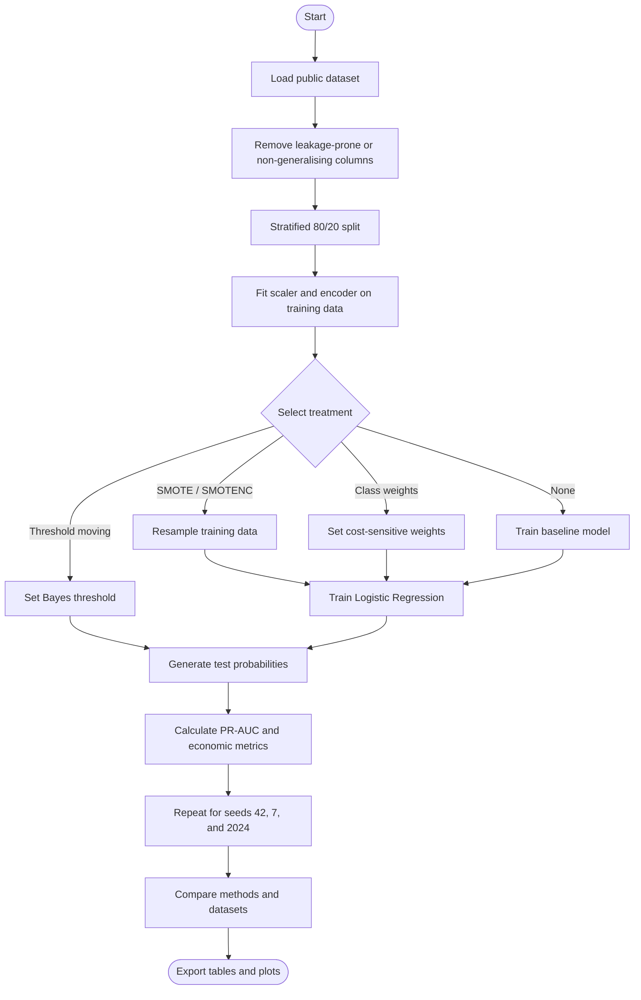
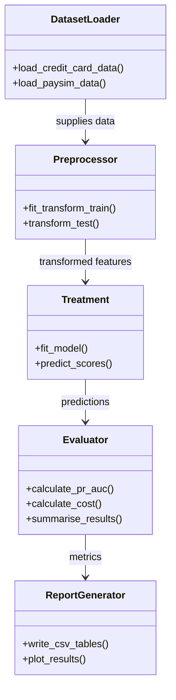

# Processing Flow and UML-style Model View

## Experiment flowchart

## UML-style component relationships

## Notebook interface design

This is a notebook-based project rather than a deployed web application. The user interface is the Jupyter/Google Colab notebook, organised into data loading, preprocessing, model training, evaluation, visualisation, and reproducibility sections.
