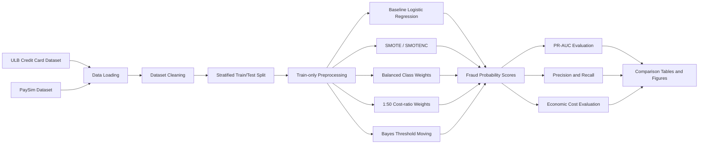

# System Architecture

## High-level architecture

## Main components

| Component | Responsibility |
|---|---|
| Data loading | Reads the ULB and PaySim public datasets. |
| Preprocessing | Scales numerical features and encodes categorical features using training data only. |
| Imbalance handling | Applies SMOTE, SMOTENC, class weights, or threshold moving. |
| Classifier | Trains Logistic Regression models. |
| Evaluation | Calculates PR-AUC, precision, recall, false positives, false negatives, and economic cost. |
| Reporting | Produces CSV result tables and comparison plots. |
