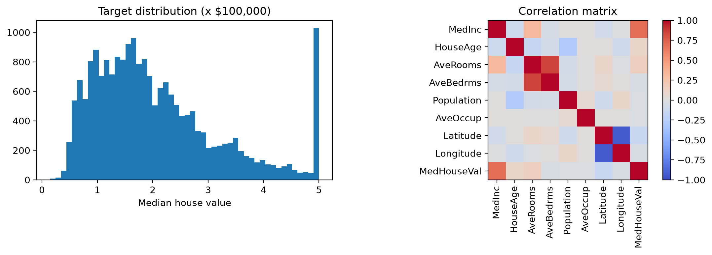
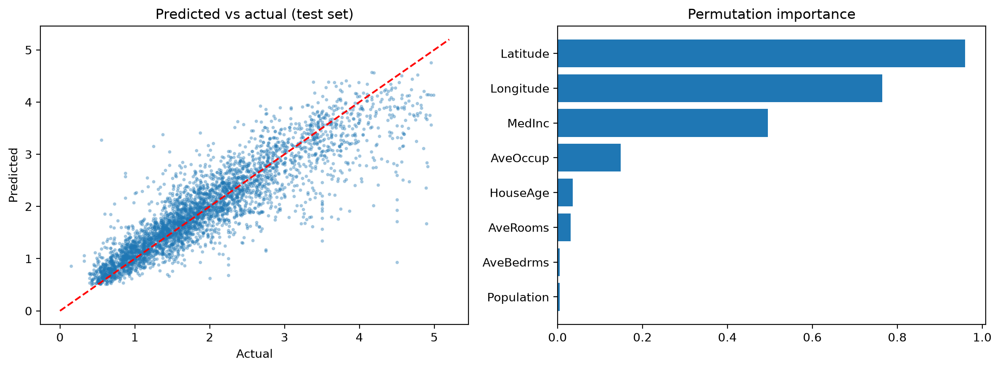
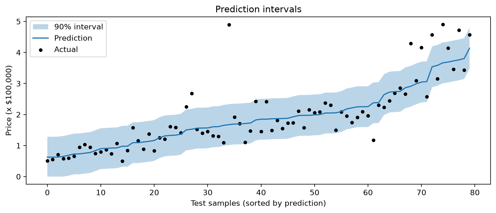
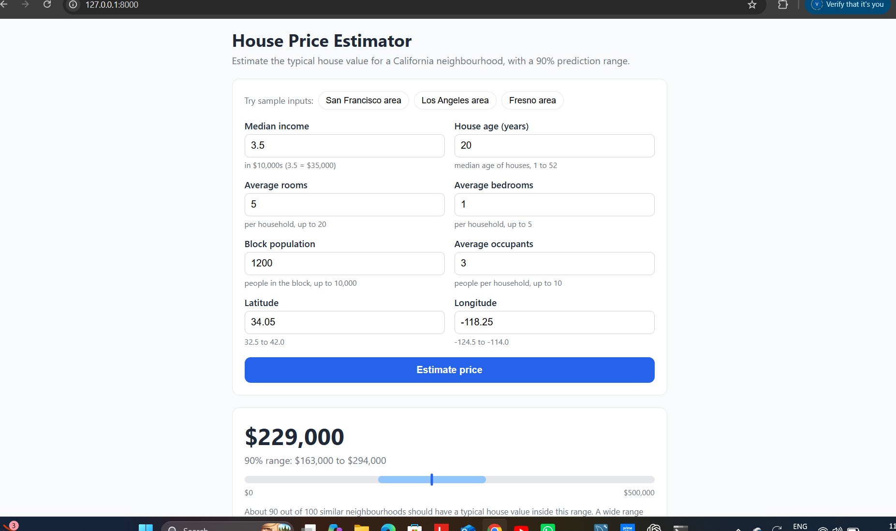

# Group 07 – Applied Machine Learning Project

## Team Members
1. Aryan Pahal – 2481098
2. Vidushi Sehrawat – 2481170
3. Gautam Budhiraja – 2481047

## Project Title
Conformal Prediction Intervals for California House-Price Estimation: A FastAPI Functional MVP (Team Iconics, Track 4 – Functional MVP)

## Project Description
A web app that estimates the typical house value of a California census block and shows a 90% prediction range instead of a single number. The model is gradient boosting trained on the California Housing dataset (1990 census), with split conformal prediction for the interval. It is served by a FastAPI endpoint with input validation and a single-page web interface.

## Source Code
All code is in [`house-price-estimator/`](house-price-estimator/). To run it:

    cd Group-07/house-price-estimator
    python3 -m venv .venv
    source .venv/bin/activate
    pip install -r requirements.txt
    python -m pytest
    python -m uvicorn app.main:app --reload

Then open http://127.0.0.1:8000/ (Windows: activate with `.venv\Scripts\Activate.ps1`).

- `app/` FastAPI backend and `app/static/index.html` web page
- `src/` data cleaning, training and conformal intervals
- `notebooks/modelling.ipynb` full analysis with plots
- `models/model.joblib` trained model
- `tests/` 8 API tests
- `report/` metrics, figures and usability test notes

## Project Design
California Housing data (20,640 blocks) → rule-based cleaning (19,522 blocks) → 60/20/20 train/calibration/test split (seed 42) → compare Linear Regression, Random Forest and Gradient Boosting → split conformal calibration gives the interval half-width q → model and q saved to `model.joblib` → FastAPI `POST /predict` (Pydantic range checks, HTTP 422 on bad input) → web page shows the price, the 90% range and a range bar.

## Results and Screenshots
Test-set errors (units of $100,000):

| Model | RMSE | MAE |
|---|---|---|
| Linear regression | 0.6014 | 0.4473 |
| Random forest | 0.4739 | 0.3162 |
| Gradient boosting | 0.4398 | 0.2998 |

- 90% interval: empirical coverage 0.899 (target 0.90), half-width 0.6579 (about $65,800).
- Automated tests: 8 passed.
- Example (default inputs): $229,000 with a 90% range of $163,000 to $294,000.

