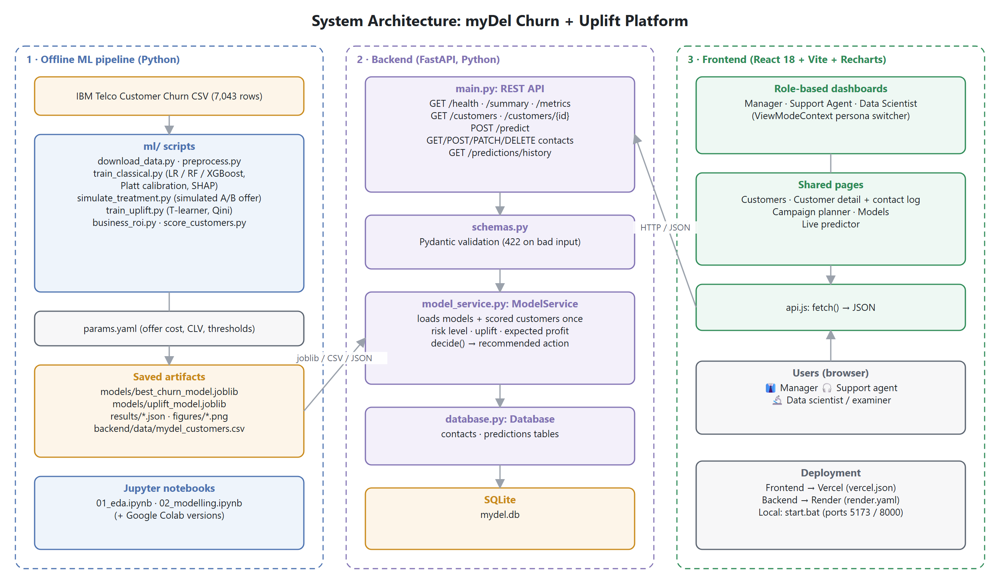
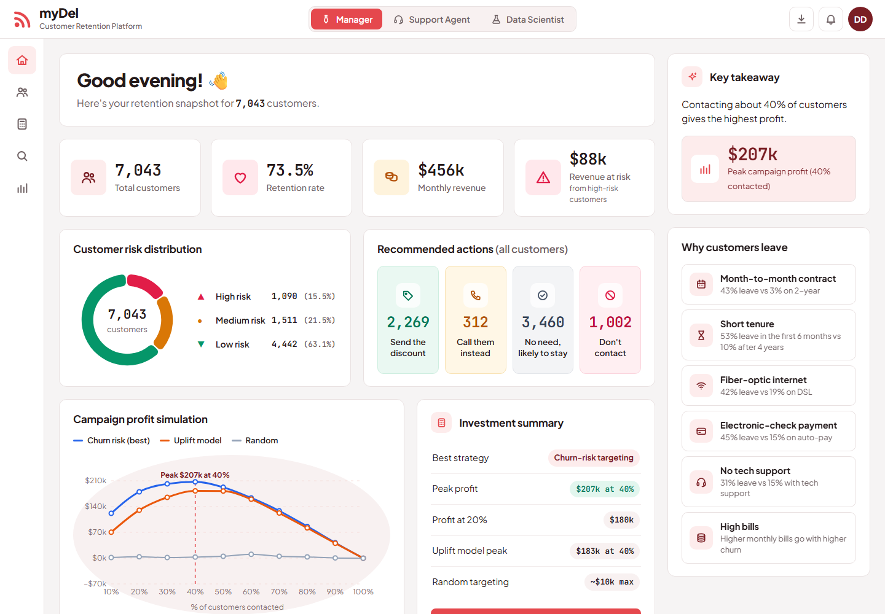
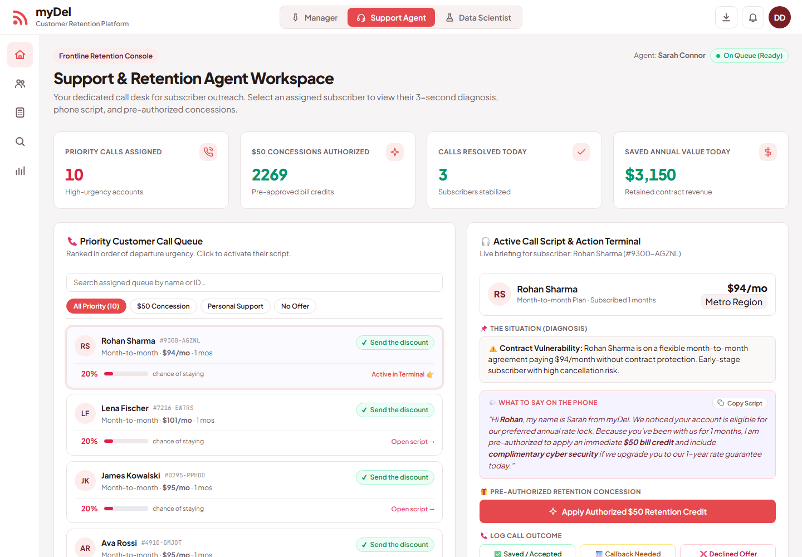
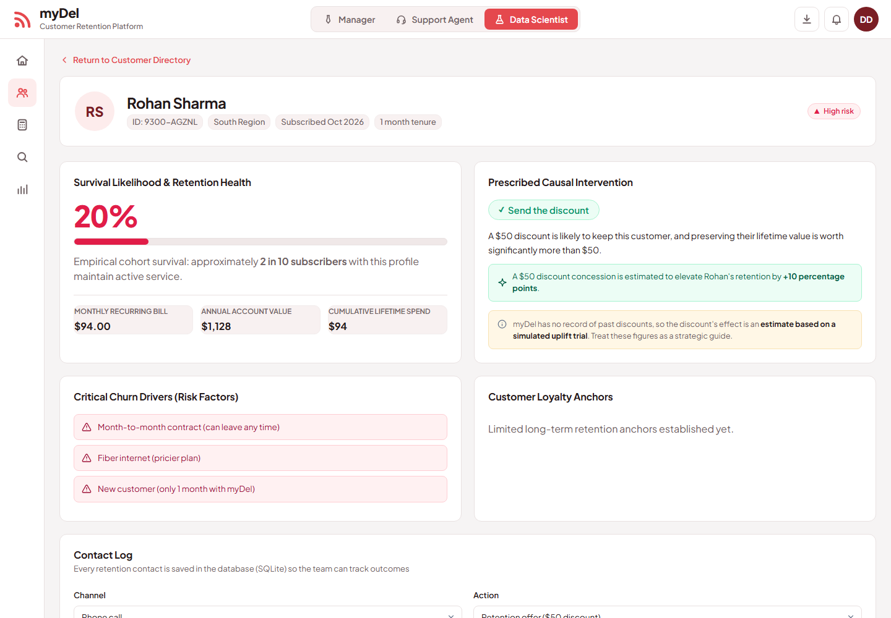
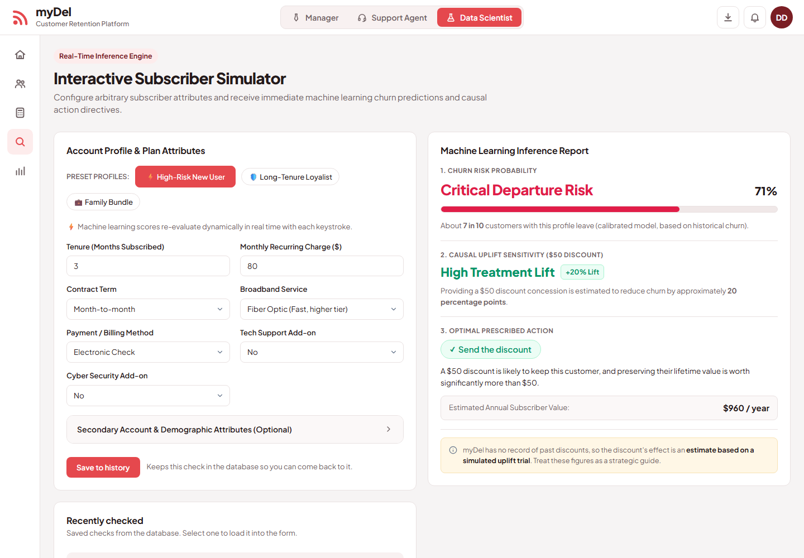
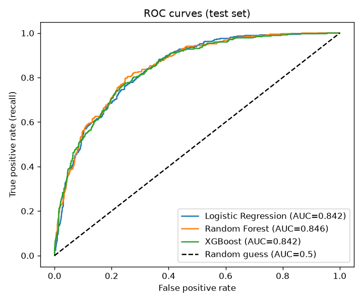
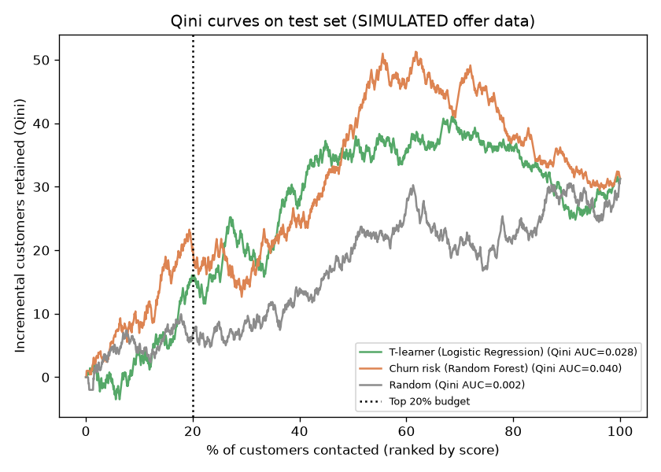

# Group 11 – Applied Machine Learning Project

## Team Members
1. Devansh Datta – 2481058
2. Taksh Sehrawat – 2481139
3. Mahak Arora – 2481059

## Project Title
**Customer Churn Prediction with Simple Uplift Extension**
*(Track 3 Project Showcase · Topic A)*

## Project Description
Telecom companies lose revenue when customers leave ("churn"). Giving every customer a retention discount wastes money, so the real question is **which customers to contact, and what to offer them**.

We built an end-to-end machine-learning system for **myDel**, a fictional phone and internet company. Its 7,043 customers are the real, anonymous records of the public **IBM Telco Customer Churn** dataset (26.5% churn rate).

**Objectives**
1. Clean and explore the data, and find the main churn drivers.
2. Train and compare classical churn models (Logistic Regression, Random Forest, XGBoost) with metrics suited to imbalanced data.
3. Make the predicted probabilities trustworthy (calibration) and explainable (SHAP).
4. Extend churn prediction with a simple **uplift model** (T-learner) that estimates whose decision a $50 retention offer would change.
5. Turn model scores into a **business recommendation** with ROI.
6. Deliver everything in a web app with a database for logging customer contacts.

> **Note:** the dataset has no record of who received a retention offer. The offer and its effect are **simulated** with documented assumptions, so the uplift and profit results show how the method works. They are not real campaign results.

**Technologies used**

| Layer | Tools |
|---|---|
| Data and ML | Python 3.12, pandas, scikit-learn, XGBoost, SHAP, scikit-uplift, matplotlib, seaborn |
| Notebooks | Jupyter, Google Colab |
| Backend | FastAPI, Pydantic, SQLite, pytest |
| Frontend | React 18, Vite, Recharts |

## Source Code
- Full project: [`Source-Code/churn-uplift/`](Source-Code/churn-uplift/) (also on GitHub: https://github.com/Devansh5150/amlclassproject)
  - `ml/`: data download, cleaning, model training, uplift, ROI and customer scoring scripts, plus the saved models
  - `backend/`: FastAPI API, SQLite database and 11 automated tests
  - `frontend/`: React app with Manager, Support agent and Data scientist views
  - `notebooks/`: EDA and modelling notebooks (Google Colab versions included)
- Dataset: [`Dataset/`](Dataset/) (raw and cleaned IBM Telco CSV)
- Documentation: [`Documentation/`](Documentation/) (project report PDF, ML technical guide, 50 viva questions and answers)

**Run it** (from `Source-Code/churn-uplift/`):
```bash
py -3.12 -m venv venv
venv\Scripts\activate
pip install -r requirements.txt
cd frontend && npm install && cd ..
start.bat                      # opens the app at http://127.0.0.1:5173
pytest backend/tests -q        # 11 tests
```

## Project Design
Diagrams are in [`Project-Design/`](Project-Design/) (PNG and SVG).

| Diagram | Shows |
|---|---|
| [System architecture](Project-Design/Architecture/01_system_architecture.png) | ML pipeline → saved models → FastAPI + SQLite backend → React frontend |
| [ML pipeline flowchart](Project-Design/Flowcharts/02_ml_pipeline_flowchart.png) | Every step from raw data to the models the app loads |
| [Decision flowchart](Project-Design/Flowcharts/03_decision_flowchart.png) | How the app picks one of four actions for a customer |
| [UML class diagram](Project-Design/UML-Diagrams/04_uml_class_diagram.png) | Backend classes, the T-learner and the database tables |
| [UML sequence diagram](Project-Design/UML-Diagrams/05_uml_sequence_predict.png) | Scoring a new customer in the live predictor |
| [UML use case diagram](Project-Design/UML-Diagrams/06_uml_use_case_diagram.png) | What each type of user can do |
| [UI design brief](Project-Design/UI-Designs/Frontend_Design_Brief.pdf) | Personas, screens, colours and wording rules |



**How an action is chosen:** offer predicted to backfire (uplift < −0.02) → *Do not contact*; churn risk < 30% → *No action needed*; expected profit (uplift × 12 × monthly bill − $50) > 0 → *Send retention offer*; otherwise → *Try non-discount retention*.

## Results and Screenshots

**Churn models** (test set of 1,409 customers)

| Model | Test ROC-AUC | F1 | 5-fold CV ROC-AUC |
|---|---|---|---|
| Logistic Regression | 0.842 | 0.615 | 0.846 ± 0.012 |
| **Random Forest (chosen)** | **0.846** | **0.641** | 0.848 ± 0.011 |
| XGBoost | 0.842 | 0.624 | 0.845 ± 0.011 |

- **Calibration** (Platt scaling): average predicted churn 39.4% → 26.7% (actual 26.5%); Brier score 0.158 → 0.136.
- **Top churn drivers (SHAP):** month-to-month contract, fiber optic internet, short tenure, electronic-check payment.
- **Uplift (simulated offer):** churn-risk ranking scored a higher Qini (0.040) than the uplift model (0.028), because in our simulation the offer only saves customers who would have churned. Uplift still wasted far fewer offers on lost causes: 17 vs 56 in the top 20%.
- **Business case:** contacting the top 20% by churn risk makes **$37,264** profit (264% ROI), against $28,476 for uplift and $2,383 at random. Profit peaks at about 40% contacted.
- **Recommendation:** target the highest-risk customers first (up to about the top 40%), skip customers the uplift model flags as likely to react badly, and run a real A/B test before trusting uplift scores.

| | |
|---|---|
| **Manager dashboard**<br> | **Support agent view**<br> |
| **Customer profile**<br> | **Live predictor**<br> |
| **ROC curves**<br> | **Qini curves**<br> |

More in [`Screenshots/`](Screenshots/): all 8 app pages, 9 model output charts, 9 EDA charts, and the console output of the final training run.
