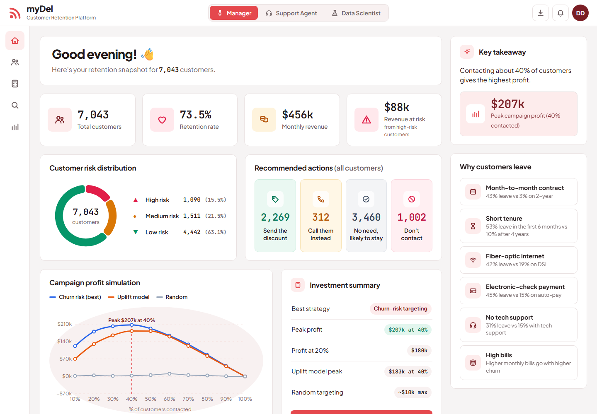
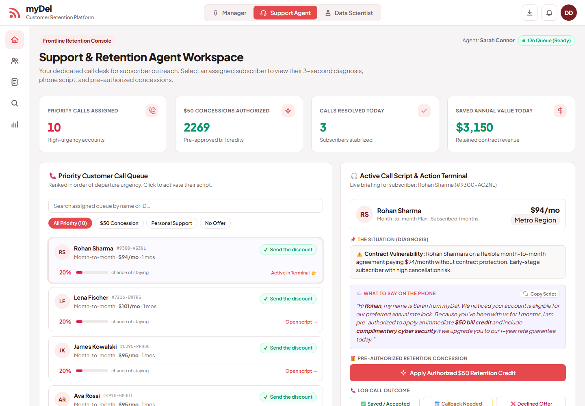
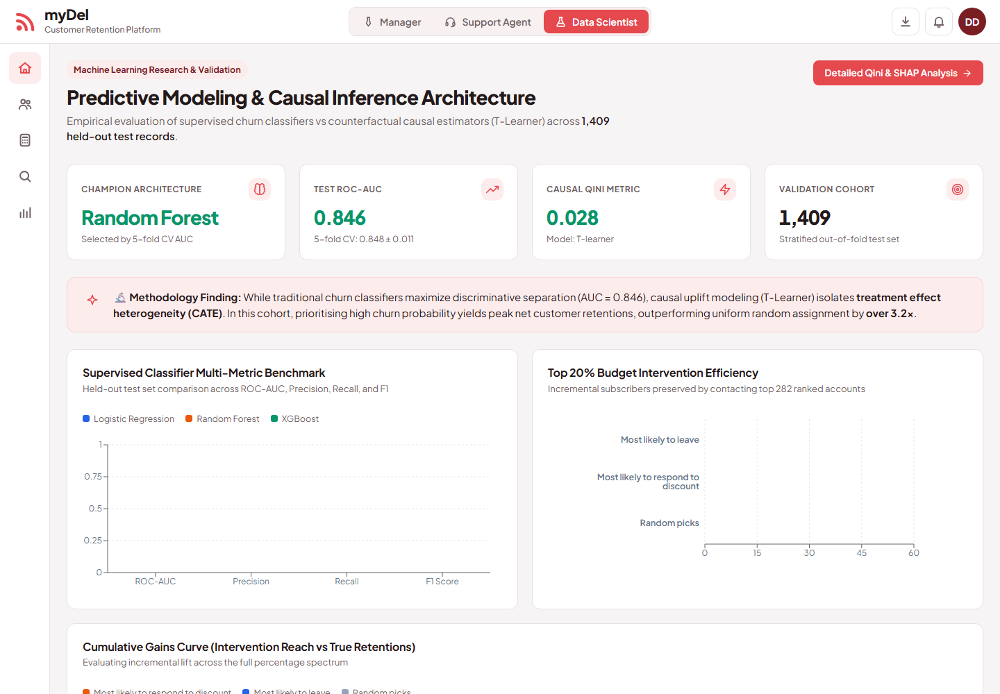
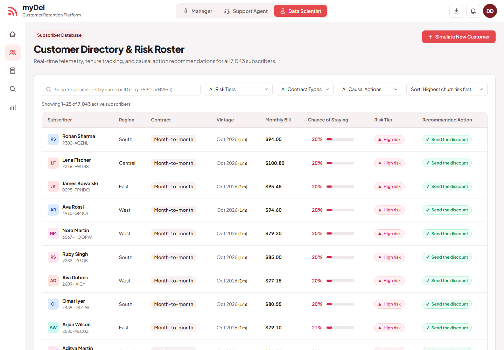
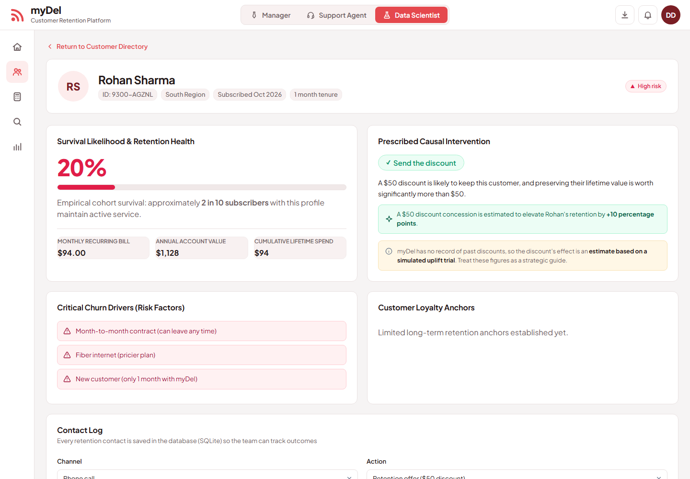
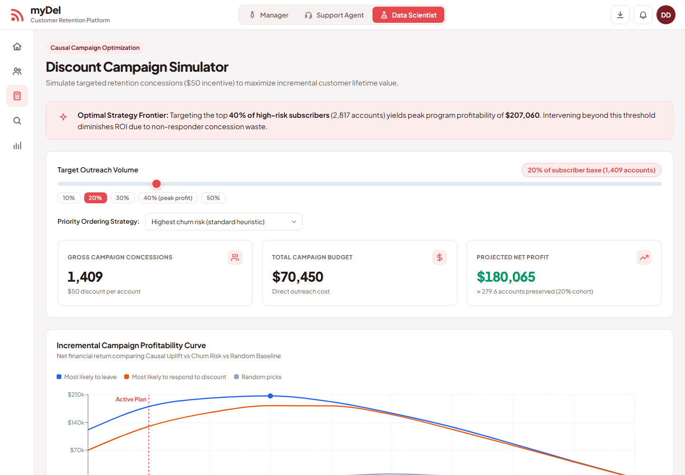
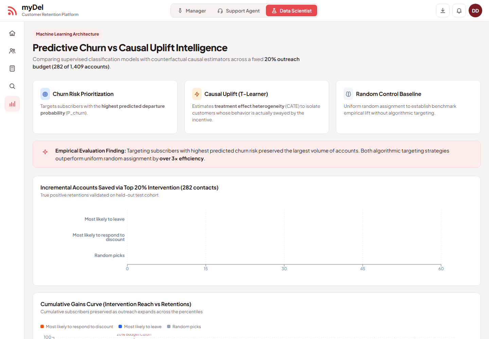
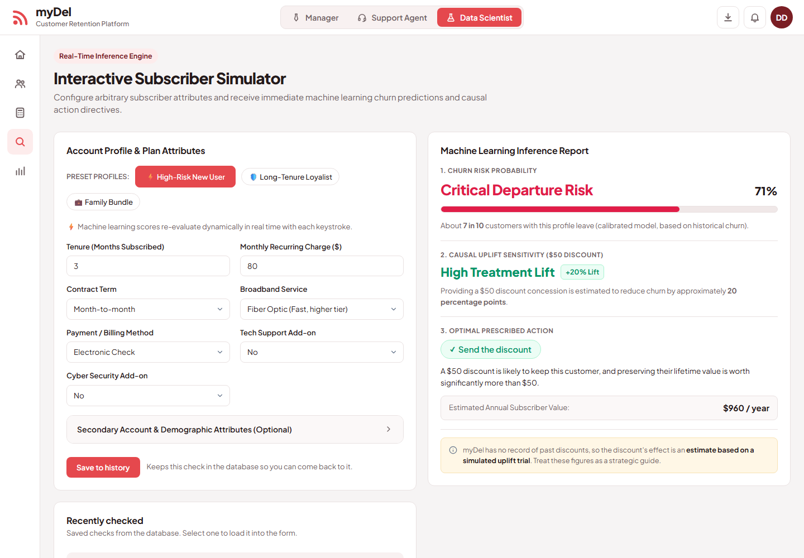

# Customer Churn Prediction with Simple Uplift Extension

> 👋 **New here or confused? Read [docs/START_HERE.md](docs/START_HERE.md) first.** For the full ML story, see **[ml-guide/](ml-guide/README.md)**. It explains everything in plain English. To run the app, double-click `start.bat`.

**Group 11 · Track 3 Project Showcase · Topic A**

The demo app is built for **myDel**, a *fictional* phone company. Its 7,043 customers are the real, anonymous IBM Telco records with generated fake names and regions.

**Phase status: all phases complete**
| Phase | What | Where |
|---|---|---|
| 1 | Project setup | folders, `requirements.txt`, `.gitignore` |
| 2 | Data download, cleaning, EDA | `ml/download_data.py`, `ml/preprocess.py`, `notebooks/01_eda.ipynb` |
| 3 | Classical churn models + SHAP + calibration | `ml/train_classical.py` → [§6.1](#61-classical-churn-models-phase-3) |
| 4 | Simulated offer + T-learner uplift | `ml/simulate_treatment.py`, `ml/train_uplift.py` → [§6.2](#62-uplift-extension-phase-4-️-simulated-treatment) |
| 5 | Business ROI + recommendation | `ml/business_roi.py`, `params.yaml` → [§7](#7-business-recommendation-phase-5) |
| 6 | FastAPI backend + SQLite + tests | `backend/` → [§8](#8-backend-api-phase-6) |
| 7 | React frontend (3 role-based views) | `frontend/` → [§9](#9-frontend-phase-7) |
| 8 | Screenshots, demo script, deployment | `docs/screenshots/` → [§10](#10-screenshots--demo-phase-8), [§11](#11-deployment) |

## 1. Problem
Telecom companies lose revenue when customers leave (churn). We:
1. Predict **who is likely to churn** using classical ML models.
2. Extend this with a basic **uplift model** that predicts **who will actually respond to a retention offer**.
3. Compare the two targeting strategies and give a **business recommendation** with ROI.

> ⚠️ **Note on uplift data:** the IBM Telco dataset has no real "treatment" column.
> The retention-offer flag and its effect on churn are **SIMULATED** with clearly
> documented assumptions (see Phase 4). Results from the uplift part show how the
> method works. They are not real campaign results.

## 2. Dataset
- **IBM Telco Customer Churn** (public, [IBM GitHub](https://github.com/IBM/telco-customer-churn-on-icp4d)): 7,043 customers, 21 columns.
- Each row is one customer: demographics, services, contract/billing details, tenure, and `Churn` (Yes/No).
- **Churn rate: 26.5%** (imbalanced: about 3 stayers for every churner).

**Get the data** (raw CSV is not committed to git):
```bash
python ml/download_data.py   # downloads to data/raw/telco_churn.csv
python ml/preprocess.py      # cleans it  -> data/processed/telco_clean.csv
```

**Cleaning** (`ml/preprocess.py`):
- `TotalCharges` is stored as text, with 11 blanks. All 11 are new customers (tenure = 0), so they are set to 0.
- "No internet service" / "No phone service" are merged into "No" (the base-service columns already record this).
- `Churn` is converted from Yes/No to 1/0.
- Encoding (one-hot) and scaling (StandardScaler) happen inside the model pipeline and are fitted on training data only, to avoid data leakage.

**EDA highlights** (`notebooks/01_eda.ipynb`, charts in `notebooks/figures/`):
| Finding | Churn rate |
|---|---|
| Month-to-month vs two-year contract | 43% vs 3% |
| Tenure 0–6 months vs 49–72 months | 53% vs 10% |
| Fiber optic vs DSL internet | 42% vs 19% |
| Electronic check vs automatic payment | 45% vs 15–17% |
| No tech support vs has tech support | 31% vs 15% |

## 3. Tech Stack
| Layer    | Tools |
|----------|-------|
| ML       | Python, pandas, scikit-learn, XGBoost, SHAP, scikit-uplift |
| Backend  | FastAPI |
| Database | SQLite (contact log + prediction history) |
| Frontend | React (Vite) + Recharts |
| Deploy   | Vercel (frontend), Render (backend) |

## 4. Project Structure
```
churn-uplift/
  data/          raw + processed data (raw is git-ignored)
  notebooks/     EDA notebook + charts
  ml/            training + evaluation scripts, saved models, results/figures
  backend/       FastAPI app, SQLite database, tests, scored myDel customers
  frontend/      React (Vite) app
  docs/          START_HERE guide + screenshots
  ml-guide/      plain-English walkthrough of every ML step (+ viva prep)
  params.yaml    business assumptions and decision thresholds
  start.bat      one-click start on Windows
  render.yaml    backend deploy config (Render)
```

## 5. Setup
```bash
# Python 3.12 virtual environment
py -3.12 -m venv venv
venv\Scripts\activate          # Windows
# source venv/bin/activate     # macOS / Linux
pip install -r requirements.txt

# Frontend (Node 18+)
cd frontend && npm install && cd ..
```

**Run the app**
- **Windows, one click:** double-click `start.bat`. It starts the backend and frontend and opens http://127.0.0.1:5173.
- **Manually (two terminals, from the project root):**
  ```bash
  # terminal 1: backend  -> http://127.0.0.1:8000  (API docs at /docs)
  uvicorn backend.app.main:app --reload
  # terminal 2: frontend -> http://127.0.0.1:5173
  cd frontend && npm run dev
  ```
- **Tests:** `pytest -q` (11 API + database tests).
- **Retrain everything from scratch:** see [ml-guide/09_reproduce.md](ml-guide/09_reproduce.md). Fixed seeds give the same numbers on every run.

## 6. Results

### 6.1 Classical churn models (Phase 3)
```bash
python ml/train_classical.py
```
- 80/20 stratified train/test split (seed 42). Test set: 1,409 customers.
- Encoding and scaling happen inside each scikit-learn Pipeline (fitted on training data only).
- Imbalance is handled with class weights (`class_weight="balanced"`, `scale_pos_weight` for XGBoost).

| Model | ROC-AUC (test) | Precision | Recall | F1 | 5-fold CV ROC-AUC |
|---|---|---|---|---|---|
| Logistic Regression | 0.842 | 0.505 | 0.786 | 0.615 | 0.846 ± 0.012 |
| **Random Forest** ✅ | **0.846** | **0.537** | **0.794** | **0.641** | 0.848 ± 0.011 |
| XGBoost | 0.842 | 0.522 | 0.775 | 0.624 | 0.845 ± 0.011 |

*(Precision, recall and F1 use a 0.5 probability cut-off.)*

**Reading the table:** all three models are close. The gaps (≤0.004 AUC) are smaller than the cross-validation spread (±0.011),
so no model is clearly better. Random Forest is saved as the best model (`ml/models/best_churn_model.joblib`)
because it has the highest test ROC-AUC and F1. It catches **79% of churners** (recall). About **half** of the customers it flags
actually churn (precision 54%). That trade-off is fine when a retention offer is cheap compared with losing a customer.

**Top churn drivers (SHAP, Random Forest):** month-to-month contract, fiber-optic internet, short tenure,
no two-year contract, electronic-check payment, and high monthly charges all push predictions towards churn.
These match the EDA findings. Charts are in `ml/results/figures/`.

**Calibration (fixing the probabilities):** class weights help recall but push every probability up. The raw Random Forest
predicted **39.4%** churn on average when the real rate is **26.5%**. That doesn't hurt *ranking* (ROC-AUC), but the app shows these
numbers as "chance of staying", so the saved model is wrapped in `CalibratedClassifierCV` (sigmoid / Platt scaling, 5-fold on training data).

| Random Forest (test set) | Mean predicted churn | Brier score (lower = better) | ROC-AUC |
|---|---|---|---|
| Before calibration | 39.4% | 0.158 | 0.846 |
| **After calibration** | **26.7%** (actual 26.5%) | **0.136** | **0.846** |

The precision / recall / F1 table above uses the uncalibrated models at a 0.5 cut-off, to compare the three models like-for-like.
Chart: `calibration_curve.png`. SHAP explanations use the uncalibrated model (calibration rescales the scores but doesn't change which features matter).

### 6.2 Uplift extension (Phase 4): ⚠️ SIMULATED treatment
```bash
python ml/simulate_treatment.py   # prints the simulated design
python ml/plot_simulation.py      # chart: ml/results/figures/sim_design.png
python ml/train_uplift.py         # trains T-learner + compares rankings
```

**The data has no real offer column, so we SIMULATE one** (`ml/simulate_treatment.py`, all numbers are assumptions):
- A random 50% of customers "receive a retention offer" (like an A/B test, seed 2024).
- Customers without the offer keep their **real** churn outcome. For customers with the offer, real churners are "saved" at an assumed rate per segment:

| Segment (assumed) | Rule | Assumed effect of offer |
|---|---|---|
| Persuadable | Month-to-month, tenure ≤ 12 | saves 40% of churners |
| Other month-to-month | Month-to-month | saves 20% |
| Lost cause | Fiber + electronic check + bill > $90 | saves 5% |
| Contract | Other 1/2-year contract | saves 5% |
| Sleeping dog | Two-year, tenure > 48 | **backfires**: 3% of stayers churn |

Overall simulated effect: churn 26.0% without the offer vs 20.5% with it.

**T-learner:** one model on customers who got the offer, one on customers who didn't. Uplift = P(stay | offer) − P(stay | no offer).
Base learner chosen by 5-fold cross-validated Qini on training data: **Logistic Regression** (0.049 vs 0.041 for XGBoost).

**If we can only contact the top 20% (282 test customers), which ranking saves more customers?**

| Ranking | Qini AUC | Observed uplift in top 20% | Expected customers saved (true, simulated) | Lost causes contacted |
|---|---|---|---|---|
| **Churn risk (Random Forest, calibrated)** | **0.040** | 12.7 pts | **58.2** | 56 |
| T-learner (Logistic Regression) ✅ chosen | 0.028 | 10.9 pts | 50.9 | 17 |
| T-learner (XGBoost) | 0.030 | 13.2 pts | 56.0 | 21 |
| Random | 0.002 | 5.0 pts | 19.8 | 27 |
| *Best possible (oracle)* | | | *94.9* | |

**Honest result: in this simulation, churn-risk ranking wins at the 20% budget.**
- **Why:** in our design the offer only helps customers who would actually churn. So the true benefit ≈ churn risk × response rate, and churn risk carries most of that signal.
  The T-learner has to estimate a *difference* of two noisy models from about 2,800 customers per group, which is much harder than predicting churn.
- **What uplift does well:** it avoids lost causes (17 contacted vs 56 for churn ranking), which is exactly what it is designed to do.
- **When uplift would win:** when the people who respond are *different* from the people at risk (for example, risky customers who ignore offers), or with much more experiment data.
- **Both curves peak at about 60–65% contacted, then fall.** Contacting *everyone* saves fewer customers than contacting the right 60%, because of the sleeping dogs.
- The same conclusion holds in 5-fold CV on the training data (churn risk 43.7 vs uplift 38–40 saved per fold), and "risk filtered by uplift" hybrids did not beat plain risk ranking.

Charts: `qini_curves.png`, `uplift_gain.png`, `uplift_by_decile.png`, `sim_design.png` in `ml/results/figures/`.

## 7. Business Recommendation (Phase 5)
```bash
python ml/business_roi.py
```
**Assumptions** (demo values in `params.yaml`): offer cost **$50** per contacted customer; value of keeping a customer = **MonthlyCharges × 12** (about $780 on average).
Effects come from the **simulated** offer, so the $ figures are illustrative.

Profit on the 1,409 test customers:

| Contact top | Churn risk | Uplift (T-learner) | Random |
|---|---|---|---|
| 10% | $25,486 | $17,187 | $1,623 |
| **20%** | **$37,264** (ROI 264%) | $28,476 | $2,383 |
| 30% | $40,705 | $37,010 | $1,844 |
| **40%** | **$42,459** ← max | $41,369 | $2,967 |
| 60% | $33,957 | $33,036 | $1,237 |
| 100% | $1,168 | $1,168 | $1,168 |

**Recommendation**
1. At a 20% budget, **target by churn risk**: $37.3k profit vs $28.5k for uplift and $2.4k for random.
2. The most profitable campaign size is **about the top 40%**. Contacting more *reduces* profit, because extra offers go to customers who would stay anyway or who react badly.
3. Use the uplift model as a **filter**: skip customers with clearly negative predicted uplift (below −0.02, set by `backfire_margin` in `params.yaml`). Values within ±0.02 of zero are noise between the two T-learner models, not real "sleeping dogs".
4. Run a **real A/B test** of the offer before trusting uplift scores, because the effects here are simulated.

## 8. Backend API (Phase 6)
FastAPI app in `backend/app/`. Models and the scored customer file are loaded **once** at start-up (`model_service.py`).
The 7,043 myDel customers are scored **out-of-fold** by `ml/score_customers.py`, so no customer is scored by a model that saw them in training (out-of-fold ROC-AUC 0.846).

| Endpoint | Purpose |
|---|---|
| `GET /health` | API up, models loaded, customer count |
| `GET /summary` | dashboard numbers: retention, revenue at risk, risk counts, top drivers |
| `GET /customers` | search / filter / sort / paginate the customer list |
| `GET /customers/{id}` | one customer: chance of staying, uplift, reasons (SHAP), recommended action |
| `POST /predict` | score any customer profile (`?save=true` stores it in history) |
| `GET /metrics` | classical, uplift and ROI results for the model pages |
| `GET/POST /customers/{id}/contacts`, `PATCH/DELETE /contacts/{id}` | contact log (SQLite) |
| `GET /contacts`, `GET /contacts/stats`, `GET /predictions/history` | campaign tracking |

**Decision rules** (`ModelService.decide`, thresholds in `params.yaml`), checked in order:
1. Predicted uplift < −0.02 → **Do not contact** (offer may backfire)
2. Churn probability < 0.30 → **No action needed**
3. Uplift × (12 × monthly bill) − $50 > 0 → **Send retention offer**
4. Otherwise → **Try non-discount retention** (service call, fix the root problem)

Input is validated with Pydantic (e.g. negative tenure returns a 422 error). Tests in `backend/tests/` use a temporary database, so they never touch `backend/data/mydel.db`.

## 9. Frontend (Phase 7)
React 18 + Vite + Recharts in `frontend/`. One app with **three views**, switched at the top:

| View | Route | For |
|---|---|---|
| Manager | `/manager` | KPIs, risk mix, recommended actions, campaign profit curve, why customers leave |
| Support Agent | `/agent` | call queue of at-risk customers, call script, log the outcome |
| Data Scientist | `/scientist` | model metrics, calibration, Qini, SHAP |

Shared pages: `/customers` (directory + CSV export), `/customers/:id` (customer profile + contact log), `/campaign` (budget slider → profit), `/models` (model comparison), `/predict` (score a new customer).
Every page that shows uplift numbers carries the **"simulated offer"** disclaimer.

## 10. Screenshots & Demo (Phase 8)
| | |
|---|---|
| **Manager overview**<br> | **Support agent**<br> |
| **Data scientist**<br> | **Customer directory**<br> |
| **Customer profile**<br> | **Campaign planner**<br> |
| **Model comparison**<br> | **Live predictor**<br> |

**5-minute demo script**
1. **Manager view:** "myDel has 7,043 customers and a 26.5% churn rate. $88k of monthly revenue sits with high-risk customers."
2. **Campaign profit chart:** profit peaks at about 40% contacted, and contacting everyone earns almost nothing. Churn-risk targeting beats uplift and random.
3. **Customers → open the top customer:** show chance of staying, the SHAP reasons in plain English, and the recommended action with its reason.
4. **Support Agent view:** pick a customer in the call queue, add a note and click an outcome (e.g. "Saved / Accepted"). Open that customer's profile: the call now appears in their **Contact Log**, saved in SQLite.
5. **Predictor:** enter a new month-to-month, fiber, e-check customer and watch the risk jump. Switch to a two-year contract and watch it drop.
6. **Data Scientist view:** ROC-AUC 0.846, calibration fixed the 39% → 26.7% average, and uplift **lost** to churn risk in our simulation, with the reason.
7. **Close with the honest caveat:** the uplift effects are simulated. A real A/B test is the next step.

## 11. Deployment
Config is ready. It needs your own Render and Vercel accounts.
1. **Backend → Render:** New → Blueprint → pick this repo (`render.yaml` creates service `mydel-api`). After the frontend is live, set `CORS_ORIGINS` to the Vercel URL.
2. **Frontend → Vercel:** import the repo, set root directory `frontend`, and set the env var `VITE_API_URL` to the Render URL. `vercel.json` handles page routes.
3. Check `https://<render-url>/health` returns `"status": "ok"`.

Note: the free Render plan sleeps when idle, so the first request after a pause takes about 30–60 s. Open the site once before a live demo.

## 12. Limitations
- The retention-offer effect is **simulated**, so all uplift and $ results illustrate the method. They are not evidence about real customers.
- The simulation's design favours churn-risk ranking (the offer only helps real churners), so "risk beats uplift" partly follows from our assumptions.
- The Logistic Regression T-learner cannot learn interaction rules like "fiber AND e-check AND bill > $90", so it mislabels some segments.
- Model hyperparameters were set by hand, not tuned, because the three models were already within CV noise.
- See [ml-guide/10_limitations_and_viva.md](ml-guide/10_limitations_and_viva.md) for more detail and viva questions.
